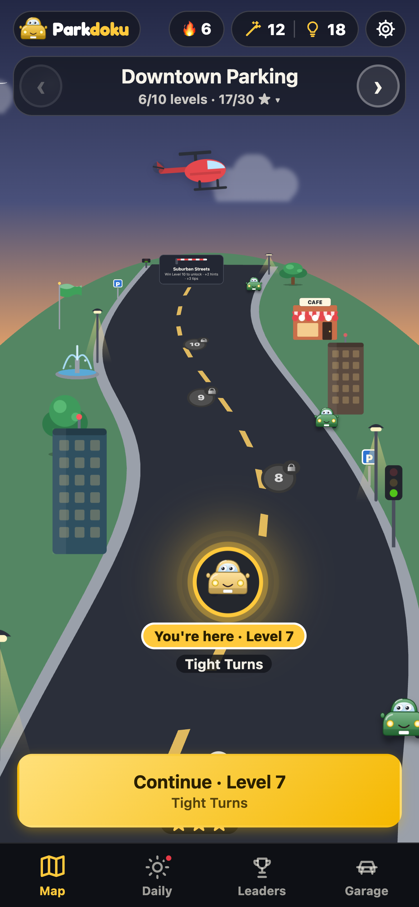
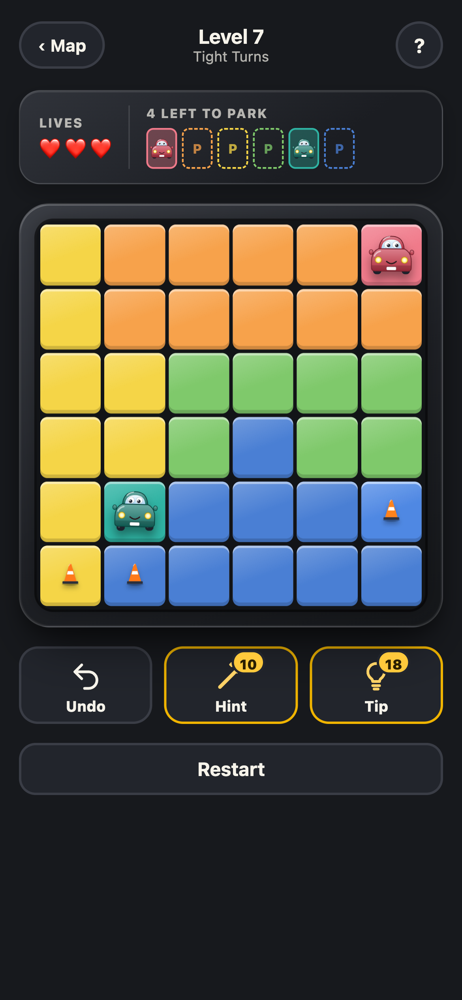
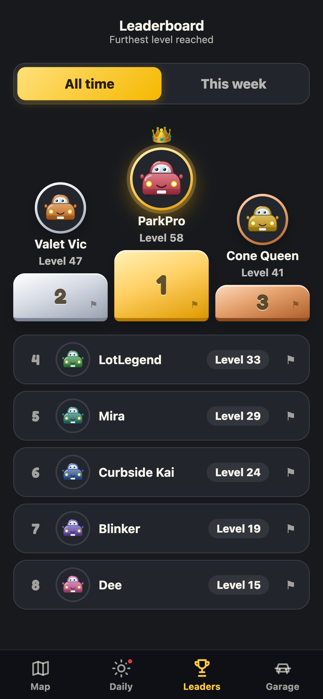
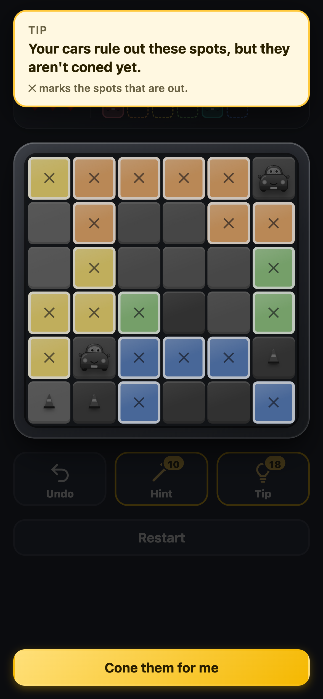
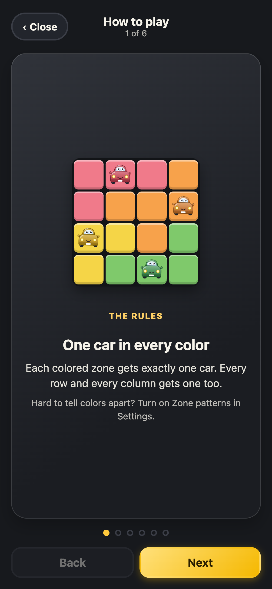
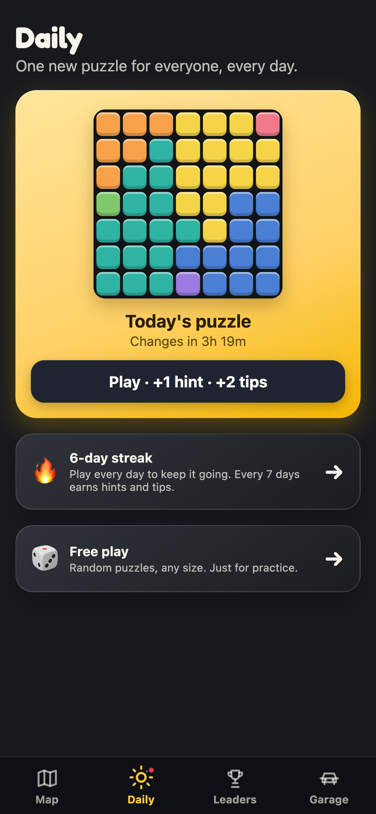
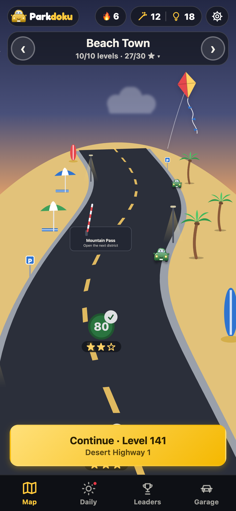
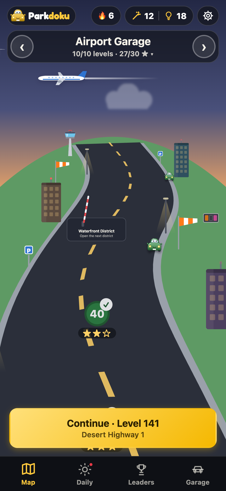
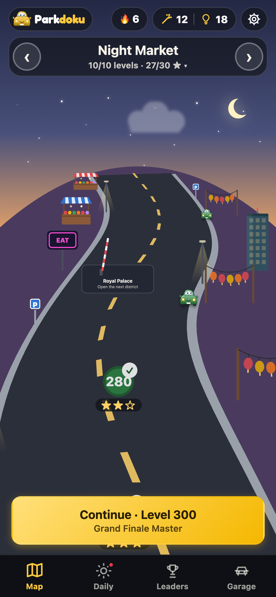
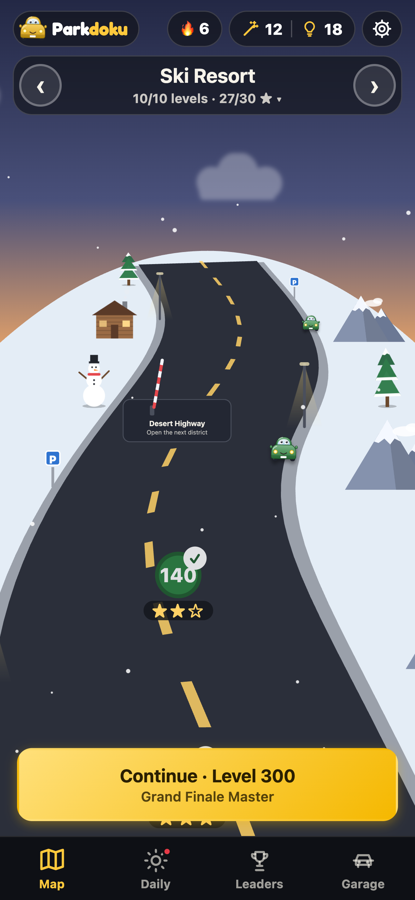

<div align="center">

# 🚗 Parkdoku

**A parking-lot logic puzzle for iPhone, Android and the web.**
Park one car in every colored zone, without two cars sharing a row or column, or touching.

*Coming to the App Store in 2027 · Google Play to follow*





</div>

---

## The game

Each level is a grid of colored zones. The goal is to place exactly one car in every zone, every row and every column, with no two cars touching, even diagonally. Every puzzle has exactly one solution and can be solved by logic alone, without guessing.

- **300 levels across 30 districts:** downtown, the suburbs, the airport, the beach, a ski resort, a night market and more. Each district has its own scenery.
- **Daily Challenge:** one new puzzle for everyone each day, with a streak to keep going.
- **Hints and tips:** a hint parks the next car; a tip explains *why* a spot works or doesn't, step by step, with the board highlighted.
- **Global and weekly leaderboards,** with server-verified results.
- **Garage:** car styles unlocked by finishing districts and keeping streaks.
- **Accessible:** color-blind zone patterns, screen-reader labels, keyboard play, large-text layouts and reduced-motion support.

## Screenshots

| Street map | Puzzle | Tip |
|:---:|:---:|:---:|
|  |  |  |
| **How to play** | **Leaderboard** | **Daily** |
|  |  |  |

**Every district has its own world**

| Beach Town | Airport | Night Market | Ski Resort |
|:---:|:---:|:---:|:---:|
|  |  |  |  |

## How it's built

Designed and built end to end by one developer: game design, art direction, frontend, backend, testing and store release.

| Layer | Technology |
|---|---|
| App | React 19, TypeScript, Vite |
| iOS and Android | Capacitor (one codebase for all three platforms) |
| Backend | Firebase: Cloud Functions, Firestore, Authentication, Hosting |
| Sign-in | Anonymous play, plus optional Google and Apple sign-in |
| Ads | Google AdMob rewarded ads (phone apps only) |
| Testing | Vitest, 700+ automated tests |

```
 Phone app / website  ──►  Cloud Functions  ──►  Firestore
  (plays fully offline)     (verify every win)    (progress, leaderboards)
```

**Highlights**

- **Results the server can trust.** The phone never tells the server what a puzzle looks like. Cloud Functions rebuild each puzzle from its seed and check the submitted board, the level order and the solve time before a win counts. Players can't write to the database directly, so the leaderboards can't be faked from the client.
- **Procedural levels with a designed difficulty curve.** Levels are generated and then graded by a solver that measures which reasoning steps a puzzle needs, so difficulty ramps steadily and every puzzle can be solved by logic.
- **A smooth 60 fps map.** The pseudo-3D street map (a road curving over a globe-shaped horizon, with momentum scrolling) is drawn directly in a `requestAnimationFrame` loop instead of re-rendering React on every frame. Scenery animations pause while the map moves.
- **Built for unreliable networks.** The game works fully offline. Wins made without a connection are queued on the device and sent once it's back, with their stars.
- **Cost-aware.** Reads, caching and rate limits are designed to keep the backend inside Firebase's free tier as the player base grows.
- **Privacy first.** Anonymous by default, a leaderboard name only if the player picks one, name reporting and moderation, and full account deletion from inside the app.

## Status

In final testing ahead of the App Store launch. The source code is private.

**Demo on request:** [linkedin.com/in/zia-syed-dev](https://www.linkedin.com/in/zia-syed-dev/)

<sub>© 2026 Zia Syed. All rights reserved. Screenshots show sample player names.</sub>
